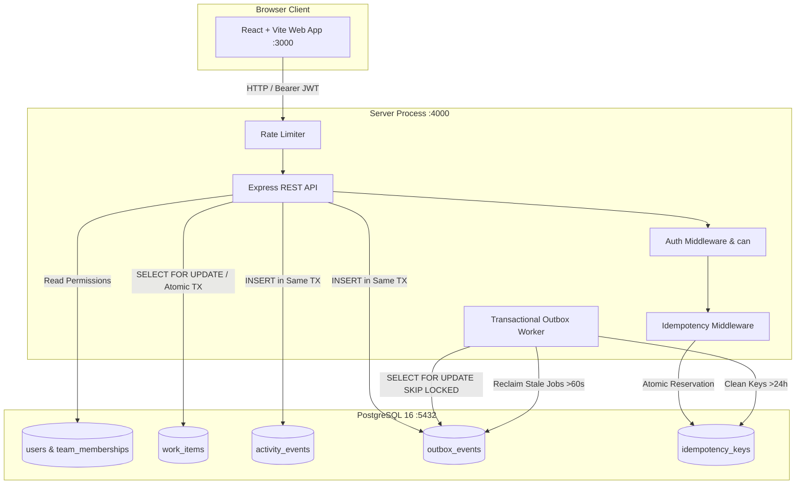
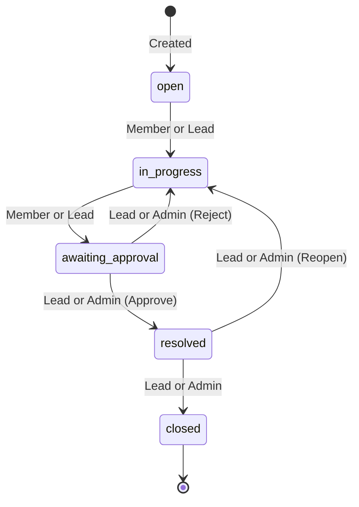
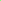
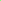
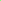
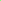

# Workdesk

Workdesk is an internal enterprise work-item management platform designed for cross-functional operations and engineering teams. It coordinates task lifecycles, team assignments, and multi-tier approval workflows under high concurrency, backed by PostgreSQL and Express with a React + Vite frontend. All operations enforce strict server-side authorization via team boundaries, optimistic concurrency control, atomic transactional audits, and resilient background job processing via the transactional outbox pattern.

---

## Features

- **Role-Based Authorization & Tenant Scoping:** Pure server-side policy evaluation (`can(user, action, item)`) across Administrator, Team Lead, Member, and Viewer roles. Users outside a team receive `404 NOT_FOUND` to prevent ID enumeration.
- **Enforced Lifecycle State Machine:** Strict lifecycle transitions (`open` → `in_progress` → `awaiting_approval` → `resolved` → `closed`), requiring team lead or administrator approval to resolve or reject items.
- **Concurrency & Claim Protection:** Optimistic concurrency control via integer `version` columns, atomic single-winner conditional claim queries (`assignee_id IS NULL`), and row-level locking (`SELECT FOR UPDATE`) on lifecycle transitions.
- **Transactional Outbox & Automatic Recovery:** Atomic dual-write prevention writing work items, audit activity events, and outbox jobs in a single database transaction. Background worker automatically reclaims jobs stuck in `processing` for >60s via `locked_at` leases (migration 003).
- **Idempotency Guarantees:** Endpoints enforce `Idempotency-Key` headers scoped by `(user_id, key)` with canonical SHA-256 request payload verification, duplicate prevention, safe replay, and hourly cleanup of keys older than 24 hours.
- **Keyset Cursor Pagination & Full-Text Search:** Sub-millisecond pagination over 20,000+ seeded work items using composite B-Tree indexes `(created_at DESC, id DESC)` and GIN-indexed full-text search.
- **Accessible & Responsive Web UI:** Polished interface featuring accessible control labels, `:focus-visible` outlines, keyboard shortcuts (`Esc` closes modals/detail panels, `Enter` submits forms), relative timestamps with exact hover tooltips, loading skeletons, empty states, and concurrency conflict banners.
- **Production Security Hardening:** Express rate limiting on authentication (10 attempts / 15 min per IP/email), constant-time login checks against dummy hashes to eliminate user enumeration, OWASP security headers via Helmet, and strict JWT secret validation (minimum 32 characters).

---

## Quick Start

Launch the entire stack (PostgreSQL, Express API, and React frontend) with zero manual configuration using Docker Compose:

### 1. Copy Environment File

```bash
# Bash (macOS / Linux)
cp .env.example .env

# PowerShell (Windows)
Copy-Item .env.example .env
```

### 2. Start Services

```bash
docker compose up --build
```

### 3. Open Application

Open [http://localhost:3000](http://localhost:3000) in your browser and sign in using any demo account with the shared demo password:

```
Demo@12345
```

- **Web UI:** [http://localhost:3000](http://localhost:3000)
- **API Server:** [http://localhost:4000](http://localhost:4000)
- **API Health Check:** [http://localhost:4000/api/items?limit=1](http://localhost:4000/api/items?limit=1)

---

## Demo Users

The database automatically migrates and seeds 10 enterprise demo users with varied roles across 3 teams (**Billing & Payments**, **Core Platform**, **Customer Operations**). All users share the password `Demo@12345`:

| Name              | Email                         | System Role                             | Team Memberships                                            | Password     |
| :---------------- | :---------------------------- | :-------------------------------------- | :---------------------------------------------------------- | :----------- |
| **Alex Vance**    | `alex.vance@workdesk.test`    | System Administrator (`is_admin: true`) | Full administrative access across all teams                 | `Demo@12345` |
| **Priya Sharma**  | `priya.sharma@workdesk.test`  | User (`is_admin: false`)                | Billing & Payments (**Lead**)                               | `Demo@12345` |
| **Marcus Chen**   | `marcus.chen@workdesk.test`   | User (`is_admin: false`)                | Billing & Payments (**Member**), Core Platform (**Member**) | `Demo@12345` |
| **Samira Khan**   | `samira.khan@workdesk.test`   | User (`is_admin: false`)                | Billing & Payments (**Viewer**)                             | `Demo@12345` |
| **Elena Rostova** | `elena.rostova@workdesk.test` | User (`is_admin: false`)                | Core Platform (**Lead**)                                    | `Demo@12345` |
| **Lucas Silva**   | `lucas.silva@workdesk.test`   | User (`is_admin: false`)                | Core Platform (**Member**)                                  | `Demo@12345` |
| **Nina Patel**    | `nina.patel@workdesk.test`    | User (`is_admin: false`)                | Core Platform (**Viewer**)                                  | `Demo@12345` |
| **Rachel Green**  | `rachel.green@workdesk.test`  | User (`is_admin: false`)                | Customer Operations (**Lead**)                              | `Demo@12345` |
| **Sarah Jenkins** | `sarah.jenkins@workdesk.test` | User (`is_admin: false`)                | Customer Operations (**Member**)                            | `Demo@12345` |
| **David Morales** | `david.morales@workdesk.test` | User (`is_admin: false`)                | Customer Operations (**Viewer**)                            | `Demo@12345` |

---

## Project Structure

```
workdesk/
├── .github/
│   └── workflows/
│       └── ci.yml               # Automated CI (Typecheck, build, test against PostgreSQL)
├── client/                      # React + Vite frontend SPA
│   ├── public/
│   │   └── favicon.svg          # Workdesk branded favicon
│   ├── src/
│   │   ├── components/
│   │   │   ├── ErrorBoundary.tsx # React Error Boundary screen
│   │   │   ├── FilterToolbar.tsx # Accessible status, priority, team, assignee filters
│   │   │   ├── ItemDetailPanel.tsx # Detail view, actions, timeline & comments
│   │   │   ├── LoginPage.tsx    # Accessible login with autofill & quick demo sign-in
│   │   │   ├── NewItemModal.tsx # Modal form for work item creation with Idempotency-Key
│   │   │   ├── Sidebar.tsx      # Views navigation & user display role
│   │   │   ├── TopNav.tsx       # Search bar & new item action button
│   │   │   └── WorkItemTable.tsx# Keyset table with skeletons, empty states & error banners
│   │   ├── api.ts               # Typed fetch client with Bearer auth
│   │   ├── App.tsx              # Main application shell with keyboard shortcut handlers
│   │   ├── dateUtils.ts         # Consistent relative time formatting & hover timestamps
│   │   ├── index.css            # Design system tokens, focus styles & responsive layouts
│   │   ├── main.tsx             # React entry point wrapped in ErrorBoundary
│   │   └── types.ts             # Shared frontend domain models
│   ├── index.html               # Page template with title "Workdesk" and favicon link
│   ├── package.json
│   └── vite.config.ts
├── docs/
│   ├── API.md                   # Comprehensive API endpoint reference & error schemas
│   └── screenshots/             # Interface state screenshots and placeholders
│       ├── login.png
│       ├── list-with-filters.png
│       ├── item-detail-timeline.png
│       └── conflict-banner.png
├── server/                      # Express + PostgreSQL backend API & Worker
│   ├── src/
│   │   ├── __tests__/
│   │   │   ├── api.test.ts      # 36 integration tests for auth, workflow, outbox & limits
│   │   │   ├── can.test.ts      # 5 unit tests for role matrix authorization rules
│   │   │   └── setup.ts         # Isolated test database runner (workdesk_test)
│   │   ├── auth/
│   │   │   └── can.ts           # Centralized pure authorization function
│   │   ├── controllers/
│   │   │   ├── authController.ts# Login rate limiting, constant-time compare & JWT issuance
│   │   │   └── itemsController.ts# HTTP handlers for work item CRUD & transitions
│   │   ├── db/
│   │   │   ├── migrations/
│   │   │   │   ├── 001_initial_schema.sql  # Schema, composite indexes & GIN search
│   │   │   │   ├── 002_idempotency_keys.sql# Idempotency table & payload hashes
│   │   │   │   └── 003_outbox_locked_at.sql# Outbox recovery lease column & indexes
│   │   │   ├── migrate.ts       # Plain SQL migration runner with transaction safety
│   │   │   ├── pool.ts          # PostgreSQL connection pool & withTransaction helper
│   │   │   └── seed.ts          # Seed script generating 10 users, 3 teams & 20k items
│   │   ├── middleware/
│   │   │   ├── auth.ts          # JWT verification & team membership injection
│   │   │   ├── idempotency.ts   # Atomic reservation & response cache middleware
│   │   │   └── rateLimiter.ts   # Express rate limiter for authentication
│   │   ├── services/
│   │   │   └── itemService.ts   # Database transactions, queries, locking & outbox writes
│   │   ├── validators/
│   │   │   └── itemValidator.ts # Zod input validation schemas for items & comments
│   │   ├── worker/
│   │   │   └── outboxWorker.ts  # Polling worker with stale job reclamation & key cleanup
│   │   ├── app.ts               # Express application configuration & security headers
│   │   ├── errors.ts            # Typed AppError classes and HTTP status codes
│   │   └── index.ts             # Server entrypoint with JWT secret length validation
│   ├── package.json
│   ├── tsconfig.json
│   └── vitest.config.ts
├── docker-compose.yml           # Multi-container orchestration (API, Web, PostgreSQL)
├── ENGINEERING_DECISIONS.md     # 5 key architectural decisions with Context, Options & Trade-offs
├── package.json                 # Monorepo scripts (typecheck, build, test, format)
└── README.md                    # System documentation
```

---

## Architecture Diagram



---

## Workflow State Machine

Work items strictly adhere to an enforced lifecycle state machine via `POST /api/items/:id/transition`:



- Disallowed transitions return `409 Conflict` (`error: 'INVALID_TRANSITION'`).
- Attempting to approve or reject without lead/admin permissions returns `403 Forbidden`.
- Concurrent or stale transitions return `409 Conflict` (`error: 'OPTIMISTIC_LOCK_CONFLICT'`).

---

## Permission Matrix

Authorization is centralized on the server in a single pure function [`can(user, action, item)`](server/src/auth/can.ts):

| Action       |  Viewer  |             Member              | Lead | Administrator (`is_admin: true`) | Outside Team |
| :----------- | :------: | :-----------------------------: | :--: | :------------------------------: | :----------: |
| `view`       |   Yes    |               Yes               | Yes  |               Yes                |   **404**    |
| `comment`    |   Yes    |               Yes               | Yes  |               Yes                |   **404**    |
| `create`     | No (403) |               Yes               | Yes  |               Yes                |   **404**    |
| `update`     | No (403) |               Yes               | Yes  |               Yes                |   **404**    |
| `claim`      | No (403) |               Yes               | Yes  |               Yes                |   **404**    |
| `transition` | No (403) | Yes _(up to awaiting_approval)_ | Yes  |               Yes                |   **404**    |
| `approve`    | No (403) |            No (403)             | Yes  |               Yes                |   **404**    |
| `delete`     | No (403) |            No (403)             | Yes  |               Yes                |   **404**    |

> **Note:** Users outside an item's team receive `404 NOT_FOUND` on all endpoints. This prevents tenant leakage and malicious item ID enumeration.

---

## Concurrency, Idempotency, and Asynchronous Processing

- **Concurrency Control:**
  Every work item record includes an integer `version` incremented on updates. Mutations submit expected `version` and return `409 OPTIMISTIC_LOCK_CONFLICT` on mismatch; claim actions use atomic conditional `UPDATE ... WHERE assignee_id IS NULL`, and transitions acquire row-level locks via `SELECT FOR UPDATE` to eliminate race conditions.
  _Read more in [ENGINEERING_DECISIONS.md §1](ENGINEERING_DECISIONS.md#1-concurrency-control-optimistic-locking-conditional-claims-and-select-for-update-in-transitions)._

- **Idempotency Guarantees:**
  Work item creation requires an `Idempotency-Key` header scoped to `(user_id, key)` in PostgreSQL. Express middleware verifies request body SHA-256 hashes, atomically reserves keys prior to transactions, returns cached `201 Created` responses with `X-Idempotent-Replay: true` on identical replays, and rejects payload conflicts with `422 UNPROCESSABLE_ENTITY`.
  _Read more in [ENGINEERING_DECISIONS.md §4](ENGINEERING_DECISIONS.md#4-idempotency-keys-scoped-by-user_id-key-with-request-body-hashing)._

- **Asynchronous Processing & Outbox Recovery:**
  Mutating endpoints write work items, audit records (`activity_events`), and background notification events (`outbox_events`) in a single atomic database transaction. An asynchronous worker queries jobs using `SELECT ... FOR UPDATE SKIP LOCKED` with exponential backoff and automatically reclaims stale jobs stranded in `processing` for >60 seconds via `locked_at` leases (migration 003).
  _Read more in [ENGINEERING_DECISIONS.md §2](ENGINEERING_DECISIONS.md#2-transactional-outbox-pattern-atomic-activity-events-and-crash-recovery)._

---

## Testing

Workdesk includes a comprehensive automated test suite consisting of 41 tests across 2 test suites:

- **36 API Integration Tests** ([`server/src/__tests__/api.test.ts`](server/src/__tests__/api.test.ts)): Authentication, HS256 tokens, login rate limiting, security headers, constant-time dummy comparisons, workflow state machines, optimistic concurrency conflicts, parallel claim race conditions, idempotency replays/mismatches, transactional outbox retries, stale job recovery (>60s), 24h key cleanup, and input validation limits.
- **5 Unit Tests** ([`server/src/__tests__/can.test.ts`](server/src/__tests__/can.test.ts)): Pure authorization matrix rules across system administrators, team leads, members, viewers, and cross-team boundaries.

All tests execute against an isolated test database (`workdesk_test`) managed automatically by [`server/src/__tests__/setup.ts`](server/src/__tests__/setup.ts). Tests never interact with the production database.

### Running Tests

```bash
# Run full test suite
npm --prefix server test

# Run tests with verbose output
npm --prefix server test -- --reporter=verbose
```

---

## Development

### 1. Running Locally Without Docker

To run the application natively on your host machine:

1. Ensure PostgreSQL is running on port 5432.
2. Configure `.env` from `.env.example`:
   ```bash
   cp .env.example .env
   ```
3. Install dependencies from the repository root:
   ```bash
   npm install
   npm --prefix server install
   npm --prefix client install
   ```
4. Run migrations and database seed:
   ```bash
   npm run migrate
   npm run seed
   ```
5. Start development servers:
   ```bash
   # Terminal 1: Start Express API server (port 4000)
   npm run server

   # Terminal 2: Start Vite frontend server (port 3000)
   npm run client
   ```

### 2. Running a Single Test File

To execute an individual test file with Vitest:

```bash
# Run only authorization role matrix tests
npm --prefix server test src/__tests__/can.test.ts

# Run only API and workflow integration tests
npm --prefix server test src/__tests__/api.test.ts
```

### 3. Creating a Database Migration

Migrations are plain SQL files located in `server/src/db/migrations/`:

1. Create a sequentially numbered SQL file:
   ```
   server/src/db/migrations/004_add_feature_table.sql
   ```
2. Write raw DDL statements inside:
   ```sql
   CREATE TABLE IF NOT EXISTS feature_flags (
       id VARCHAR(64) PRIMARY KEY,
       enabled BOOLEAN NOT NULL DEFAULT FALSE,
       created_at TIMESTAMPTZ NOT NULL DEFAULT NOW()
   );
   ```
3. Run migrations:
   ```bash
   npm run migrate
   ```

The migration runner executes all unapplied SQL files inside transactions and records completed migrations in `schema_migrations`.

---

## Screenshots

Visual captures of Workdesk's primary interface states are referenced below and documented in [`docs/screenshots/`](docs/screenshots/README.md):

| State                       | Screenshot                                                           | Description                                                                          |
| :-------------------------- | :------------------------------------------------------------------- | :----------------------------------------------------------------------------------- |
| **Login Screen**            |                           | Sign-in interface with demo credentials picker and accessible controls               |
| **Work Items List**         |            | High-density data table with keyset cursor pagination and filter toolbar             |
| **Detail Panel & Timeline** |  | Action controls, status lifecycle options, metadata grid, and chronological timeline |
| **Concurrency Conflict**    |              | Inline 409 conflict alert banner with manual reload action                           |

---

## Known Limitations

This section documents architectural trade-offs and deliberate limitations present in the current implementation:

1. **JWT in `localStorage`:** JWT tokens are stored in browser `localStorage` on the frontend, which is vulnerable to XSS compared to secure, `httpOnly` cookies.
2. **Stateless JWTs Without Revocation:** Tokens are stateless HS256 tokens with an 8-hour expiration. There is no refresh token mechanism, sliding session, or server-side token revocation list (blocklist).
3. **Idempotency Record Outside Item Transaction:** The `idempotency_keys` reservation is executed in Express middleware prior to the item creation transaction (`withTransaction`). An ungraceful process crash between item commit and response transmission leaves the key unfinalized.
4. **Only 2xx Responses are Cached:** Idempotency keys only store successful responses (`200`-`299`). Non-2xx responses (e.g., 400 validation errors) delete the reservation to allow client correction and retry.
5. **Colocated Background Worker:** The background outbox worker runs as a polling loop within the same Node.js process as the HTTP API rather than an independent worker container.
6. **Simulated Notification Delivery:** The outbox worker's notification handler logs dispatch events to `stdout` rather than delivering real emails, webhooks, or push notifications.
7. **10-Second Polling instead of Realtime:** The UI updates via a 10-second background polling interval (`refetchInterval: 10000` via TanStack Query) rather than WebSockets or Server-Sent Events (SSE).
8. **Pessimistic UI (No Optimistic UI Updates):** Mutations wait for canonical server response before cache invalidation. Concurrency conflicts display an inline conflict banner with a manual "Reload" action.
9. **Basic English Full-Text Search:** Text search utilizes PostgreSQL's basic `'english'` dictionary configuration without typo tolerance, n-grams, or fuzzy matching.
10. **No Audit Logging for Read Access:** Read operations (`GET /api/items`) are not logged in `activity_events`; only mutating operations (create, update, claim, transition, comment) generate audit records.
11. **Unpartitioned Activity Table:** The `activity_events` table is a single unpartitioned table that will require range or list partitioning under large enterprise write volumes.

---

## What I Would Build Next

1. **Realtime Push Notifications via Server-Sent Events (SSE) or WebSockets:** Replace 10-second polling with an SSE stream backed by PostgreSQL `LISTEN/NOTIFY` or Redis pub/sub to broadcast status transitions and comments instantly.
2. **Secure `httpOnly` Cookie Authentication with Refresh Tokens:** Migrate JWT storage out of `localStorage` into secure, `httpOnly`, `SameSite=Strict` cookies with short-lived access tokens (15 minutes) and sliding refresh tokens.
3. **Distributed Caching with Redis:** Cache frequently accessed team and user lists and item details in Redis with automated cache invalidation, offloading repetitive queries from PostgreSQL.
4. **Elasticsearch / Meilisearch Integration:** Stream outbox events to a dedicated search cluster for typo-tolerant fuzzy search, n-gram autocomplete, and multi-faceted filtering.
5. **Table Partitioning for Audit & Outbox Tables:** Implement native PostgreSQL declarative range partitioning (by month or quarter) on `activity_events` and `outbox_events` to maintain query performance as history grows.
6. **Outgoing Webhook Dispatcher:** Enhance the outbox worker to deliver signed HMAC-SHA256 webhooks to external URLs with automated exponential backoff retry schedules and dead-letter queues.
