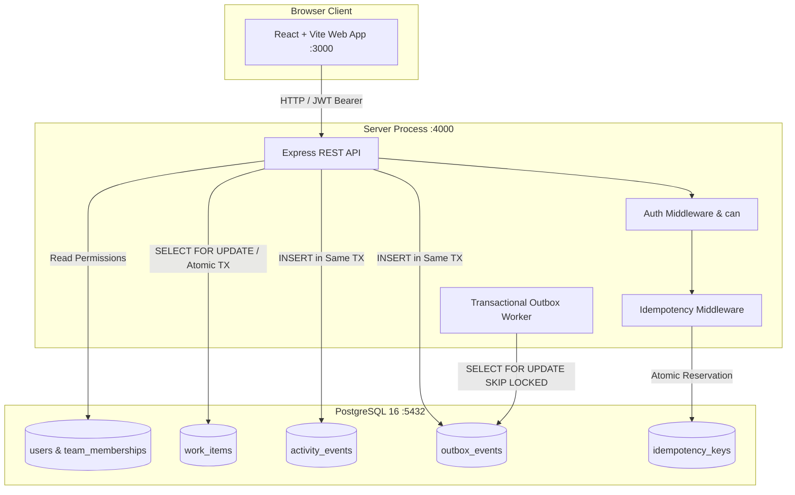
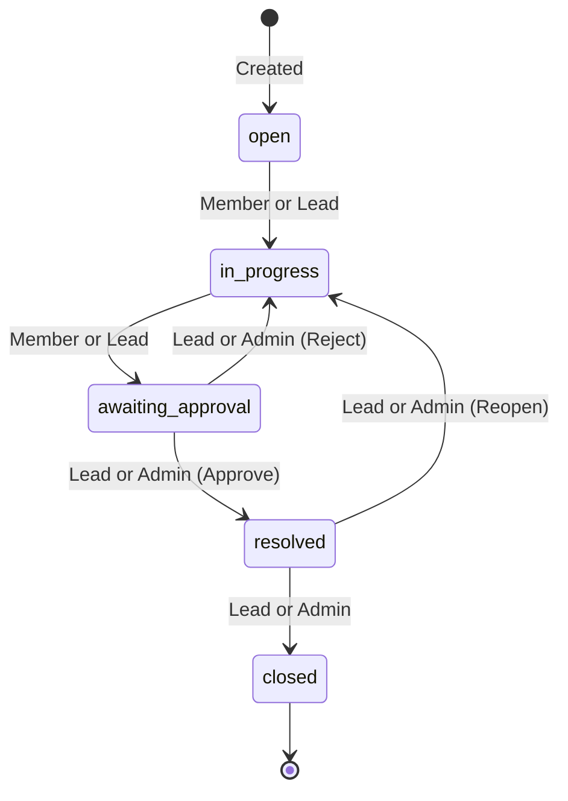

# Workdesk

Workdesk is an internal enterprise work-item management platform designed for cross-functional operations and engineering teams. It coordinates task lifecycles, team assignments, and multi-tier approval workflows under high concurrency. All operations enforce strict server-side authorization, optimistic concurrency locking, atomic transactional audits, and resilient background job processing.

---

## Prerequisites

- **Docker Desktop** (with Docker Compose support)
- **Node.js 20+** (required only if running the test suite or local build scripts outside Docker)

---

## Quick Start & Run Commands

### 1. Fresh Clone & Setup
The repository can be launched immediately using Docker Compose. `.env` is gitignored; default environment variables are embedded in `docker-compose.yml` for zero-step execution, or you can copy `.env.example`:

**PowerShell (Windows):**
```powershell
Copy-Item .env.example .env ; docker compose up --build
```

**Bash (Linux / macOS):**
```bash
cp .env.example .env && docker compose up --build
```

On first startup:
- The database schema is automatically migrated using plain SQL migrations (`001_initial_schema.sql`, `002_idempotency_keys.sql`).
- The database is automatically seeded with 10 enterprise users, 3 teams, and 20,000 realistic work items (`SEED_ITEMS=20000`).

### 2. Stopping the Application
```powershell
# Stop containers
docker compose down

# Stop and reset database volume
docker compose down -v
```

---

## Application URLs

| Service | URL | Description |
| :--- | :--- | :--- |
| **Workdesk Web UI** | [http://localhost:3000](http://localhost:3000) | Vite + React frontend |
| **Workdesk API** | [http://localhost:4000](http://localhost:4000) | Express REST API |
| **API Health & Metrics** | [http://localhost:4000/api/items?limit=1](http://localhost:4000/api/items?limit=1) | Work items endpoint |

---

## Demo Accounts & Authentication

All demo accounts share the standard password:

```
Demo@12345
```

The 10 pre-seeded enterprise users:

| Name | Email | System Role | Team Memberships |
| :--- | :--- | :--- | :--- |
| **Alex Vance** | `alex.vance@workdesk.test` | System Administrator (`is_admin: true`) | Full administrative access across all teams |
| **Priya Sharma** | `priya.sharma@workdesk.test` | User (`is_admin: false`) | Billing & Payments (**Lead**) |
| **Marcus Chen** | `marcus.chen@workdesk.test` | User (`is_admin: false`) | Billing & Payments (**Member**), Core Platform (**Member**) |
| **Samira Khan** | `samira.khan@workdesk.test` | User (`is_admin: false`) | Billing & Payments (**Viewer**) |
| **Elena Rostova** | `elena.rostova@workdesk.test` | User (`is_admin: false`) | Core Platform (**Lead**) |
| **Lucas Silva** | `lucas.silva@workdesk.test` | User (`is_admin: false`) | Core Platform (**Member**) |
| **Nina Patel** | `nina.patel@workdesk.test` | User (`is_admin: false`) | Core Platform (**Viewer**) |
| **Rachel Green** | `rachel.green@workdesk.test` | User (`is_admin: false`) | Customer Operations (**Lead**) |
| **Sarah Jenkins** | `sarah.jenkins@workdesk.test` | User (`is_admin: false`) | Customer Operations (**Member**) |
| **David Morales** | `david.morales@workdesk.test` | User (`is_admin: false`) | Customer Operations (**Viewer**) |

### Authentication Architecture
- Authentication uses `POST /api/auth/login` taking `{ email, password }`.
- Password verification is performed using `bcrypt.compare` against `password_hash`.
- Any failure returns `401 Unauthorized` with generic message: `{"error": "INVALID_CREDENTIALS", "message": "Invalid email or password"}`.
- Successful login returns an `HS256` JWT with an 8-hour expiry containing only `sub` (the user ID).
- `JWT_SECRET` must be set in the environment; the server refuses to start without it.

---

## Running Automated Tests

All tests run against a dedicated, isolated test database named **`workdesk_test`** configured in [`server/src/__tests__/setup.ts`](file:///c:/dev/newtonite-ops-23131011348/server/src/__tests__/setup.ts).

> **Important:** Tests **never** read from or write to the production `workdesk` database. The test setup connects to PostgreSQL, creates `workdesk_test` if missing, runs all migrations, and truncates all tables before each test to guarantee complete test isolation.

Run tests using:

**PowerShell:**
```powershell
npm --prefix server test -- --reporter=verbose
```

**Bash:**
```bash
npm --prefix server test -- --reporter=verbose
```

---

## Architecture Diagram



---

## Permission Matrix

Authorization is centralized on the server in a single [`can(user, action, item)`](file:///c:/dev/newtonite-ops-23131011348/server/src/auth/can.ts) function:

| Action | Viewer | Member | Lead | Administrator (`is_admin: true`) | Outside Team |
| :--- | :---: | :---: | :---: | :---: | :---: |
| `view` | Yes | Yes | Yes | Yes | **404** |
| `comment` | Yes | Yes | Yes | Yes | **404** |
| `create` | No (403) | Yes | Yes | Yes | **404** |
| `update` | No (403) | Yes | Yes | Yes | **404** |
| `claim` | No (403) | Yes | Yes | Yes | **404** |
| `transition` | No (403) | Yes *(up to awaiting_approval)* | Yes | Yes | **404** |
| `approve` | No (403) | No (403) | Yes | Yes | **404** |
| `delete` | No (403) | No (403) | Yes | Yes | **404** |

*Note: Users outside an item's team receive `404 NOT_FOUND` on all endpoints to prevent cross-tenant information leakage and ID enumeration.*

---

## Workflow State Machine

Work items follow an enforced lifecycle state machine via `POST /api/items/:id/transition`:



- Disallowed transitions return `409 Conflict` with `error: 'INVALID_TRANSITION'`.
- Attempting to approve or reject without lead/admin permissions returns `403 Forbidden`.
- Concurrent or stale transitions return `409 Conflict` with `error: 'OPTIMISTIC_LOCK_CONFLICT'`.

---

## Known Limitations

This section documents architectural trade-offs and known limitations present in the current implementation:

1. **No Login Rate Limiting:** The `POST /api/auth/login` endpoint does not implement IP- or account-based rate limiting, leaving it susceptible to automated brute-force attempts.
2. **Timing Disparity on Unknown Emails:** Password verification returns immediately if an email is not found, creating a measurable timing delta compared to existing accounts where `bcrypt.compare` executes.
3. **JWT in `localStorage`:** JWT tokens are stored in browser `localStorage` on the frontend, posing an XSS exposure risk compared to `httpOnly` secure cookies.
4. **No JWT Refresh or Revocation:** Tokens are stateless HS256 with an 8-hour TTL. There is no refresh token mechanism, sliding session, or server-side token revocation list (blocklist).
5. **Post-Response Idempotency Persistence:** The idempotency middleware updates `status_code` and `response_body` in an asynchronous callback after `res.json` sends data to the client. An ungraceful process crash in this narrow window would leave the key unfinalized.
6. **Only 2xx Responses are Cached:** Idempotency keys only store successful responses (`200`-`299`). Non-2xx responses (e.g. 400 validation errors) delete the reservation to allow client correction and retry.
7. **Idempotency Keys Never Expire:** The `idempotency_keys` table does not have an automatic TTL or background cleanup cron, meaning records accumulate over time.
8. **Colocated Outbox Worker:** The background outbox worker runs as a `setInterval` loop in the same Node.js process as the HTTP API. Under heavy processing loads, this worker can contend for CPU cycles and database connections with user traffic.
9. **Simulated Notification Delivery:** The outbox worker's notification handler logs dispatch events to `stdout` rather than delivering real emails, webhooks, or push notifications.
10. **Polling Instead of Realtime:** The UI updates via polling intervals rather than WebSockets or Server-Sent Events (SSE), introducing a short latency before external updates appear.
11. **Basic English Full-Text Search:** Text search utilizes PostgreSQL's basic `'english'` dictionary config without typo tolerance, n-grams, or fuzzy matching.
12. **No Audit Logging for Read Access:** Read operations (`GET /api/items`) are not logged in `activity_events`; only mutating operations (create, update, claim, transition, comment) generate audit records.
13. **Unpartitioned Activity Table:** The `activity_events` table is a single unpartitioned table that will require range or list partitioning under production enterprise write volumes.
